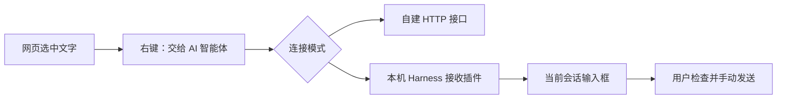
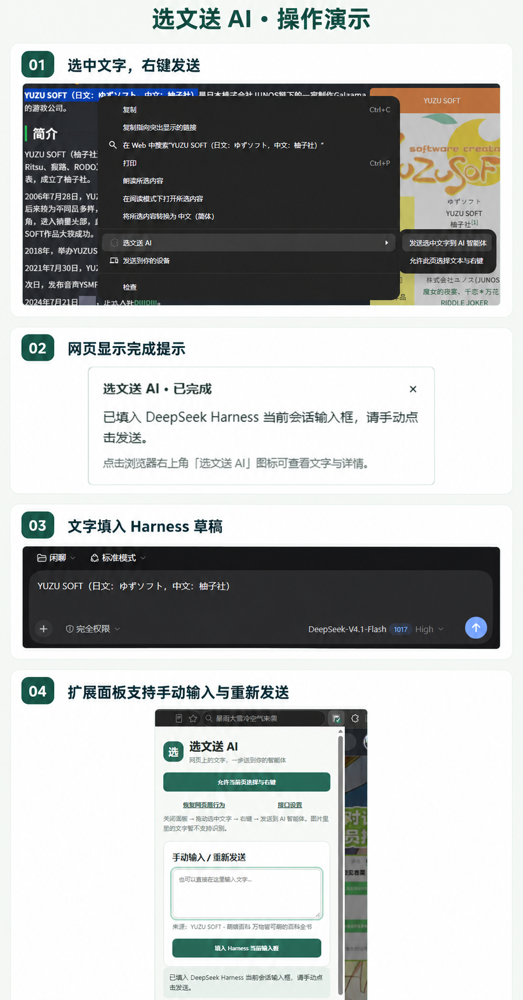

# 选文送 AI · WebClip to AI

**把网页选中的文字，交给你的 AI 智能体。**

[English](README.en.md) · [安装教程](docs/INSTALL.zh-CN.md) · [常见问题](docs/TROUBLESHOOTING.zh-CN.md) · [隐私说明](PRIVACY.md)

选中文字后，通过浏览器右键菜单提交到自建 HTTP 接口；配合接收插件，也能把文字填入 **DeepSeek Harness 桌面版当前会话输入框**，由你检查后再发送。

> **预览版 v1.2.1**：38 项自动化检查和 11 项实际 Harness Host/HTTP 接入检查已通过。Edge + Harness 的右键交付、多行、旧草稿保留、一次撤销、选字辅助恢复和刷新已由用户协助验收；Chrome、完整浏览器重启和部分边界场景仍待验证。未上架扩展商店；接收插件目前仅适配 `dsh 0.2.1-rc.2`。[详细验收记录](docs/ACCEPTANCE_2026-10-31.zh-CN.md)

## 能做什么

- **右键交给智能体**：保留选文中的中文、引号、换行和反斜杠。
- **选字与右键辅助**：按页启用，处理常见 CSS 和页面事件限制；可恢复或刷新撤销。
- **Harness 草稿模式**：写入当前输入框，保留已有草稿，不自动提交消息。
- **通用 HTTP 模式**：配置 POST 地址、Bearer Token、额外请求头与 JSON 模板。
- **明确反馈**：显示处理过程与结果；未配置时打开设置页，失败后保留文字供重新操作。
- **每台电脑独立配对**：Harness 在本机生成配对文件，公开源码与发布包均不包含通用密钥。
- **无第三方运行依赖**：扩展原生 JavaScript；接收插件使用 Node.js 标准库。

## 工作方式



浏览器扩展负责交付文字。模型选择、模型 API 密钥和实际模型调用由智能体端处理。

当前组件版本：**浏览器扩展 1.2.1 / Harness 接收插件 1.2.0**。1.2.1 修正右键选文丢失换行的问题，只需重新加载浏览器扩展；已有 Harness 接收插件无需重装。
## 操作演示

选中网页文字，通过右键菜单填入 Harness 当前草稿，由你检查后发送。


## 快速开始

### 只用通用接口

1. 下载 Release 的扩展 ZIP 并解压，或直接使用源码中的 `extension/`。
2. 打开 `chrome://extensions` 或 `edge://extensions`，开启开发者模式，加载包含 `manifest.json` 的文件夹。
3. 点扩展图标 → **接口设置**，填写真实接收 API，保存并授权访问。
4. 选中文字 → 右键 → **发送选中文字到 AI 智能体**。

默认请求内容：

```json
{
  "text": "选中的文字",
  "source": {
    "title": "来源标题",
    "url": "https://example.com/article"
  }
}
```

接收端须处理 `text`；普通聊天网页地址不能直接作为此接口。模式中的 HTTP 2xx 仅代表接口接收成功。

### 填入 DeepSeek Harness

1. 在 Harness 的 **插件 → 添加插件** 中，安装 Release 提供的 `harness-webclip-1.2.0.tgz`，安装后点 **立即启用**。
2. 接收插件启动时，在 Harness 主目录生成 `webclip-to-ai/connection.json`。默认 Windows 位置为 `%USERPROFILE%\.dsh\webclip-to-ai\connection.json`；设置过 `DSH_HOME` 时以该目录为准。
3. 打开浏览器扩展的 **接口设置 → DeepSeek Harness 桌面版**，导入这个文件，点 **保存 Harness 本地连接**，授权访问本机地址。
4. 在 Harness 打开普通会话并保持输入框可编辑，再回网页选字并通过右键交付。
5. 看到写入成功提示后，切回 Harness 检查草稿，再手动发送。

**这里的配对码只用于本机连接，不需要你的 DeepSeek 模型 API Key。** 请保留配对文件在本机。[分步安装说明与升级方法](docs/INSTALL.zh-CN.md)

## 模型与能力范围

| 场景 | 当前状态 |
| --- | --- |
| Edge 网页右键选文 | 核心流程已由用户协助验收，含多行和辅助恢复 / 刷新 |
| Chrome 网页右键选文 | 已实现，真实浏览器验收仍待完成 |
| DeepSeek Harness 桌面版当前草稿 | `dsh 0.2.1-rc.2` 后台接入及真实草稿核心流程通过，部分边界待验证 |
| 在 Harness 中选择 Kimi、Gemini 等模型 | 由 Harness 的模型配置与账户能力决定，扩展无需感知模型 |
| 自建智能体的 JSON POST 接口 | 已实现，需要自行提供接收端 |
| 直接填入 Kimi / Gemini / 其他聊天网页 | 未实现 |
| 图片、canvas、扫描 PDF 的文字识别 | 未实现 |
| 所有网站都能恢复复制 | 不保证；浏览器受保护页面、部分 iframe 与特殊页面存在限制 |

## 开发与测试

开发需要 Node.js 22+、Python 3.10+。**不需要安装 npm 或 Python 第三方依赖。**

```sh
npm run check
npm test
npm run build
```

构建产物写入 `dist/`：浏览器扩展 ZIP、Harness 插件 TGZ、完整安装包、源码 ZIP 与 SHA-256 校验文件。源码 ZIP 可用于创建 GitHub 仓库；安装包供最终用户使用，两者都不包含运行时配对文件。

```text
extension/                 浏览器扩展
packages/harness-webclip/   Harness 接收插件
examples/                  本地联调接收器
tests/                     自动化测试
scripts/                   检查与打包脚本
docs/                      安装、架构、验收和发布说明
.github/                   CI、Release 工作流、Issue 模板
```

运行 `python examples/local_receiver.py` 可打开本地受限选字演示页；这是联调工具，不是 AI 后端。

## 权限与隐私

扩展请求 `activeTab`、`scripting`、`contextMenus`、`storage`。仅在保存接口时申请该接收主机的访问权限；选字辅助使用用户点击时临时授予的当前页权限。没有常驻的全站内容脚本、遥测或广告。

通用接口配置保存在本机扩展存储。最近一次选文和回复保留在当前浏览器会话中。Harness 模式仅发送文字到 `127.0.0.1`，草稿由 Harness 自己管理。详见 [PRIVACY.md](PRIVACY.md) 与 [SECURITY.md](SECURITY.md)。

## 贡献与发布

- [贡献指南](CONTRIBUTING.md)
- [兼容性与手动验收](docs/TESTING.md)
- [发布到自己的 GitHub 账号](docs/PUBLISH_TO_GITHUB.zh-CN.md)
- [维护者 Release 流程](docs/RELEASING.md)
- [更新记录](CHANGELOG.md)

项目采用 [MIT License](LICENSE)。这是独立社区项目，与 DeepSeek、Google、Moonshot AI 及浏览器厂商无隶属关系。Harness 适配依据其公开插件接口编写；这些上游项目的商标与代码遵循各自许可。
